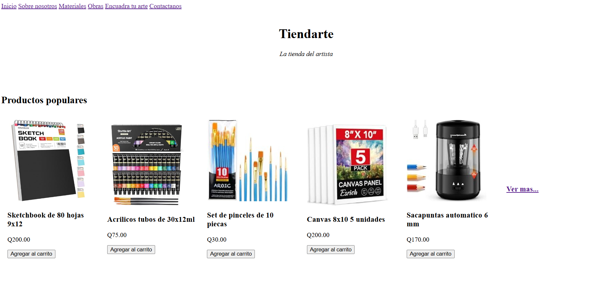
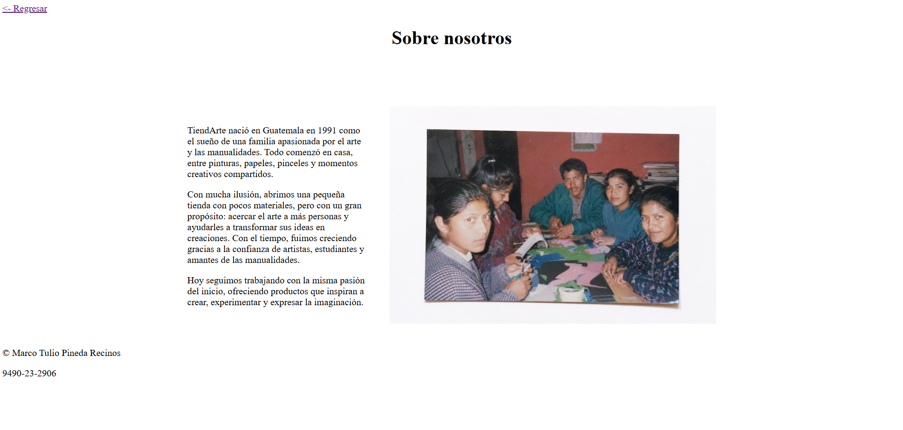
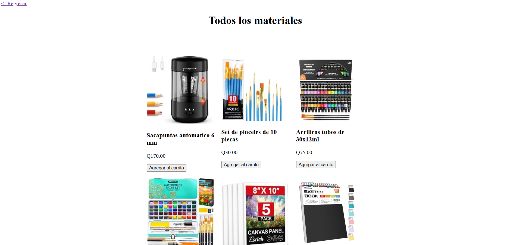
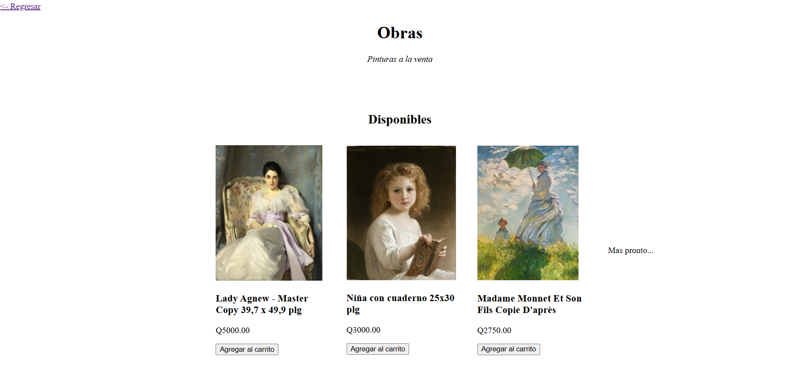
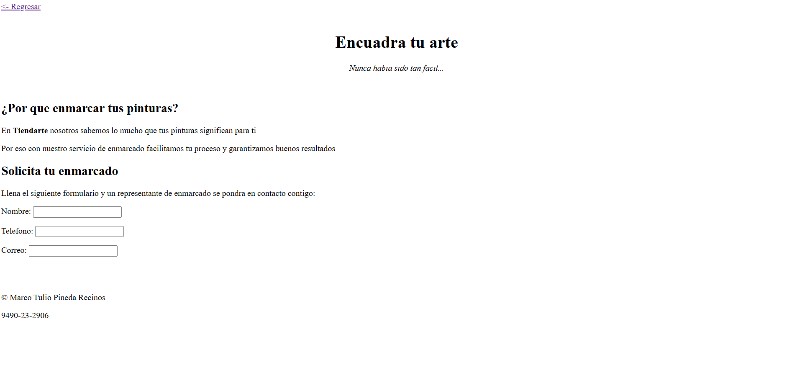
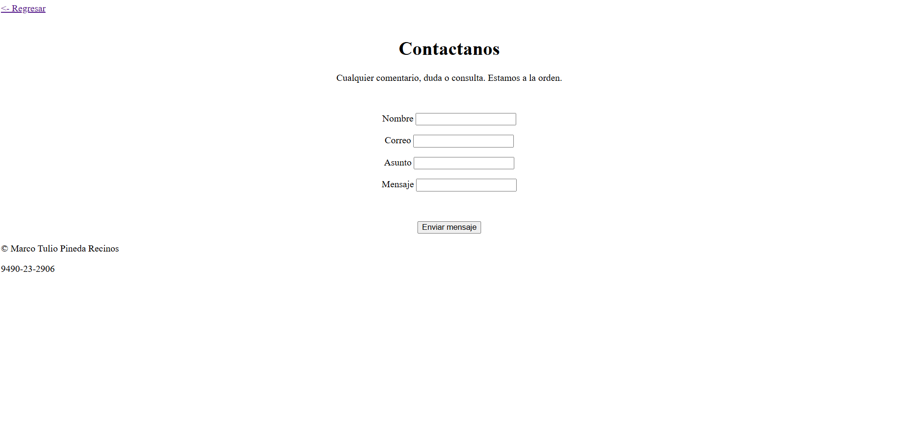

# TiendArte
Página simple en HTML puro sobre una tienda de materiales de arte.
Incluye catálogo de productos, obras a la venta, formularios y sección informativa.
## Realizado por 
Marco Tulio Pineda Recinos 
## Enlace 
[papaya-cactus-aafbf3.netlify.app](papaya-cactus-aafbf3.netlify.app)
## Previsualización






## Características
- Navegación entre las páginas del sitio
- Catálogo de productos con imágenes y precios
- Despliegue de información en tablas
- Formularios de contacto y de solicitud de enmarcado
- Estructura semántica
## Tecnologías utilizadas
- HTML5
## Estructura del proyecto
```text
Tarea1/
├── index.html
├── README.md
├── pages/
│   ├── sobre-nosotros.html
│   ├── materiales.html
│   ├── obras.html
│   ├── encuadra.html
│   └── contactanos.html
└── images/
    ├── acuarelas.jpg
    ├── calco.jpg
    ├── canvas.jpg
    ├── cuaderno-acuarela.jpg
    ├── foto.png
    ├── marcadores.jpg
    ├── painting1.jpg
    ├── painting2.webp
    ├── painting3.jpg
    ├── pintura-acrilica.jpg
    ├── posca.jpg
    ├── red1.jpg
    ├── red2.png
    ├── red3.png
    ├── sacapuntas.jpg
    ├── setpinceles.jpg
    ├── sketchbook.jpg
    ├── ss1.png
    ├── ss2.png
    ├── ss3.png
    ├── ss4.png
    ├── ss5.png
    └── ss6.png
```