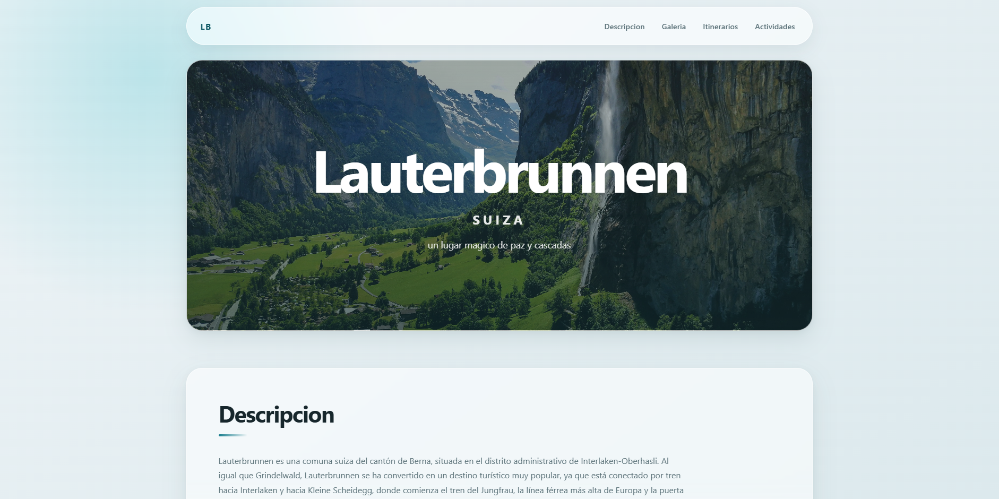

# Excursión a Lauterbrunnen

Página web desarrollada con HTML y CSS sobre una excursión a Lauterbrunnen, Suiza. Incluye una descripción del destino, galería de imágenes, itinerario de actividades y opciones adicionales para realizar durante la visita. El sitio utiliza un diseño moderno responsive con efectos de transparencia, y barra de navegacion flotante.

## Realizado por

Marco Tulio Pineda Recinos

## Enlace

https://aquamarine-pudding-61fc94.netlify.app/

## Previsualización



## Características

- Navegación entre las diferentes secciones de la página
- Barra de navegación fija 
- Diseño moderno con transparencias, sombras y efectos al pasar el cursor
- Estructura semántica del contenido

## Tecnologías utilizadas

- HTML5
- CSS3

## Estructura del proyecto

```text
HojaTrabajo2/
├── index.html
├── README.md
├── css/
│   └── style.css
└── images/
    ├── banner.jpg
    ├── landscape1.jpg
    ├── landscape2.jpg
    ├── landscape3.jpg
    ├── landscape4.jpg
    └── projectview1.png
```