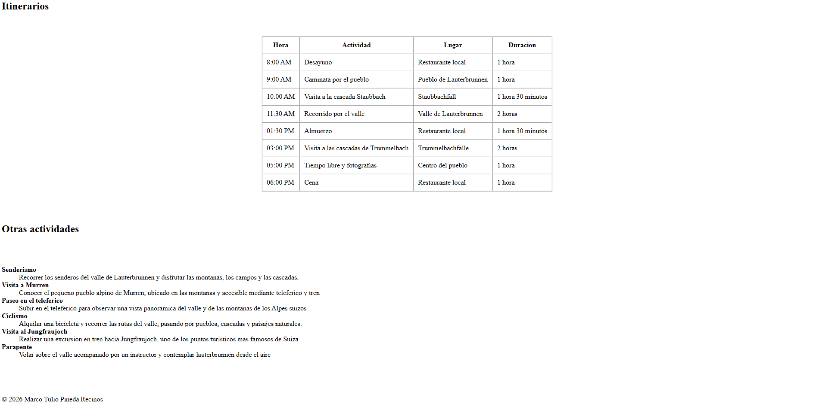

# Excursión a Lauterbrunnen

Página simple en HTML puro sobre una excursión a Lauterbrunnen, Suiza. 
Incluye galería, descripción, itinerarios y otras actividades.

## Previsualización





## Características

- Navegación entre secciones de la página
- Galería de imágenes
- Despliegue de información en tablas
- Estructura semántica

## Tecnologías utilizadas

- HTML5

## Estructura del proyecto

```text
HojaTrabajo1/
├── index.html
├── README.md
└── images/
    ├── landscape1.jpg
    ├── landscape2.jpg
    ├── landscape3.jpg
    └── landscape4.jpg
```