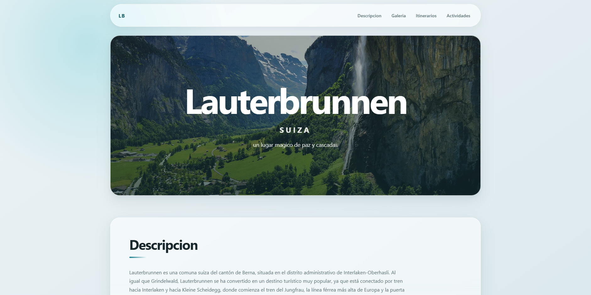

# Excursión a Lauterbrunnen

Página web desarrollada con React y Vite sobre excursion a lauterbrunnen, suiza, la cual esta compuesta por distintos componentes ubicados en src/components para una optimizacion y uso del DOM 

## Nombre y carnet 

Marco Tulio Pineda Recinos
9490-23-2906

## Enlace
https://courageous-duckanoo-aa7ab7.netlify.app/ 

## Previsualización



## Características y componentes

- Navegación entre las diferentes secciones de la página
- Barra de navegación fija
- Estructura semántica del contenido
- Galería: con visor modal al hacer clic en las imágenes
- Actividades: Filtro en tiempo real sobre la lista de actividades
- Cotizacion: Calculadora de cotización en tiempo real
- Formulario: Reservación de citas con validación de campos
- Testimonios: Sección de reseñas con varios testimonios aleatorios que cambian al hacer click en el boton "ver otra opinion"

## Tecnologías utilizadas

- React
- Vite
- ESLint
- JavaScript
- CSS3

## Instalación

```bash
npm install
npm run dev
```

## Estructura del proyecto

```text
HojaTrabajo4/
├── index.html
├── README.md
├── package.json
├── vite.config.js
├── eslint.config.js
├── public/
│   └── images/
│       ├── banner.jpg
│       ├── landscape1.jpg
│       ├── landscape2.jpg
│       ├── landscape3.jpg
│       ├── landscape4.jpg
│       └── projectview1.png
└── src/
    ├── main.jsx
    ├── App.jsx
    ├── index.css
    └── components/
        ├── Modal.jsx
        ├── Nav.jsx
        ├── Hero.jsx
        ├── Descripcion.jsx
        ├── Galeria.jsx
        ├── Itinerarios.jsx
        ├── OtrasActividades.jsx
        ├── Cotizacion.jsx
        ├── Reservacion.jsx
        ├── Resenas.jsx
        └── Footer.jsx
```
